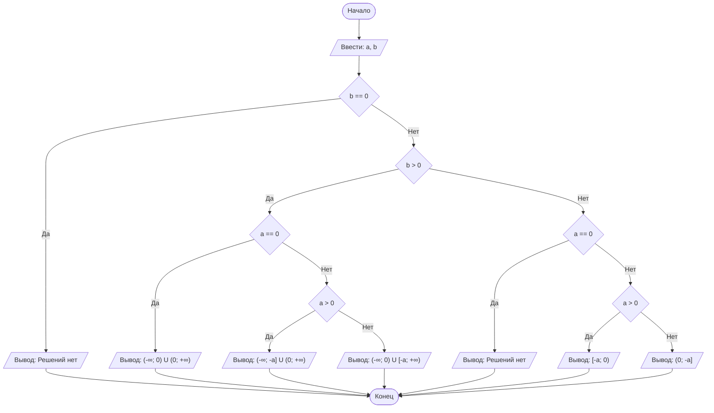

## Cодержание

1. [Отчет по лабораторной работе № 1](#отчет-по-лабораторной-работе--n)
2. [Критерии оценивания](#критерии-оценивания)

## Отчет по лабораторной работе № N

#### № группы: `ПМ-2602`

#### Выполнил: `Заяшников Егор Станиславович`

#### Вариант: `6`

### Cодержание: 

- [Постановка задачи](#1-постановка-задачи)
- [Входные и выходные данные](#2-входные-и-выходные-данные)
- [Выбор структуры данных](#3-выбор-структуры-данных)
- [Алгоритм](#4-алгоритм)
- [Программа](#5-программа)
- [Анализ правильности решения](#6-анализ-правильности-решения)

### 1. Постановка задачи

- Условия задачи

> Программа получает на вход два числа `a` и `b`, являющихся параметрами неравенства. Нужно решить неравенство $$\dfrac{x+a}{b\cdot x}\geq 0$$ относительно x и вывести множество его решений.

- Данную задачу можно разделить на 2 подзадачи: определение знака параметра `b` и решение неравенства с учётом значений параметра `a`.
- Для 1 подзадачи нужно рассмотреть 3 случая:
1. `b = 0` — решений нет, так как знаменатель обращается в ноль при любом `x`.
2. `b > 0` — знак неравенства не меняется.
3. `b < 0` — знак неравенства меняется на противоположный.
- Для 2 подзадачи нужно рассмотреть 3 случая в зависимости от значения параметра `a`:
1. `a = 0`
2. `a > 0`
3. `a < 0`
Всего при `b ≠ 0` необходимо рассмотреть 2 * 3 = 6 случаев. С учётом отдельного случая `b = 0` программа обрабатывает 7 случаев.

### 2. Входные и выходные данные

#### Данные на вход

На вход программа должна получать 2 числа — параметры `a` и `b`.
В условии не указано, к какому множеству
должны принадлежать получаемые числа, поэтому будем считать их вещественными.
Верхняя и нижняя границы получаемых чисел в условии не заданы.

|                  | Тип                |      min значение                |          max значение         |
|------------------|--------------------|----------------------------------|-------------------------------|
| `a` (параметр 1) | Вещественное число |  `-1.7976931348623157 × 10³⁰⁸`   | `1.7976931348623157 × 10³⁰⁸`  |
| `b` (параметр 2) | Вещественное число |  `-1.7976931348623157 × 10³⁰⁸`   | `1.7976931348623157 × 10³⁰⁸`  |

#### Выходные данные

|           | Тип                                       |
|-----------|-------------------------------------------|
|решения `x`|строка с промежутками  вещественных чисел  |


### 3. Выбор структуры данных

Программа получает 2 вещественных числа — параметры `a` и `b`. 
Для их хранения можно выделить 2 переменные (`a` и `b`) типа `double`,
так как этот тип позволяет хранить вещественные числа, в том числе положительные, отрицательные и ноль.

|                  | название переменной | Тип (в Java) | 
|------------------|---------------------|--------------|
| `a` (параметр 1) | `a`                 | `double`     |
| `b` (параметр 2) | `b`                 | `double`     | 

### 4. Алгоритм

1. **Ввод данных:**  
   Программа считывает два вещественных числа, обозначенные как `a` и `b`. 

2. **Проверка параметра `b`:**  
   Программа проверяет значение `b`. Если `b` равно нулю, программа выводит сообщение об отсутствии решений, 
   так как знаменатель обращается в ноль. Если `b` не равно нулю, программа переходит к следующему шагу.

3. **Проверка знака параметра `b`:**
    - Если `b` больше нуля, программа решаеь неравенство $$\dfrac{x+a}{b\cdot x}\geq 0$$. 
    - Если `b` меньше нуля, программа решает неравенство $$\dfrac{x+a}{b\cdot x}\leq 0$$. Поскольку при делении на отрицательное число 
      знак неравенства меняется на противоположный.

4. **Проверка значения параметра `a`:**
    - Если `a` равен нулю, программа определяет множество решений с учетом того, что x не равен нулю. 
    - Если `a` больше нуля, программа определяет промежутки решения с учётом расположения точки `-a` относительно нуля.
    - Если `a` меньше нуля, программа определяет промежутки решения с учётом расположения точки `-a` относительно нуля.

5. **Вывод результата:**  
   На экран выводится множество решений неравенства 
   в виде промежутков. Если решений нет, программа выводит соответствующее сообщение.





### 5. Программа


```java
import java.util.Scanner;

public class Main {
    // Объявляем объект класса Scanner для ввода данных
    public static void main(String[] args) {
        Scanner scanner = new Scanner(System.in);

        // Запрашиваем значение параметра a
        System.out.print("Введите параметр a:");
        double a = scanner.nextDouble();

        // Запрашиваем значение параметра b
        System.out.print("Введите параметр b:");
        double b = scanner.nextDouble();

        // Решаем (x + a) / (b * x) >= 0 методом интервалов
        if (b == 0) {
            //                               Случай 1: b = 0
            // знаменатель обнуляется. Так как деление на ноль запрещено
            System.out.println("Решений нет (деление на ноль, так как b = 0).");
        } else if (b > 0) {
            //                               Случай 2: b > 0
            // Если b > 0, а положительное число не влияет на знак неравенства, можно свести его к (x + a) / x >= 0
            if (a == 0) {
                //                           Случай 2.1: b > 0, a = 0
                // Если a = 0 получаем x / x >= 0. Это верно для любых x кроме нуля
                System.out.println("Ответ: (-∞; 0) U (0; +∞)");
            } else if (a > 0) {
                //                           Случай 2.2: b > 0, a > 0
                // x = -a левее нуля. Ищем интервалы со знаком +: x <= -a или x > 0
                System.out.println("Ответ: (-∞; " + (-a) + "] U (0; +∞)");
            } else {
                //                           Случай 2.3: b > 0, a < 0
                // x = -a правее нуля. Ищем интервалы со знаком +: x < 0 или x >= -a
                System.out.println("Ответ: (-∞; 0) U [" + (-a) + "; +∞)");
            }
        } else {
            //                               Случай 3: b < 0
            // При делении на отрицательное b знак неравенства меняется на противоположный: (x + a) / x <= 0
            if (a == 0) {
                //                           Случай 3.1: b < 0, a = 0
                // Получаем x / x <= 0, что дает неверное утверждение 1 <= 0
                System.out.println("Решений нет.");
            } else if (a > 0) {
                //                           Случай 3.2: b < 0, a > 0
                // x = -a левее нуля. Интервалы со знаком -: x >= -a и x < 0
                System.out.println("Ответ: [" + (-a) + "; 0)");
            } else {
                //                           Случай 3.3: b < 0, a < 0
                // x = -a правее нуля. Интервалы со знаком -: x > 0 и x <= -a
                System.out.println("Ответ: (0; " + (-a) + "]");
            }
        }
    }
}
```

### 6. Анализ правильности решения

Программа работает корректно на множестве допустимых значений параметров с учетом всех возможных случаев.

1. Тест на  `b > 0`,  `a > 0`:

- Input:
    ```
    2
    3
    ```

- Output:
    ```
    Ответ: (-∞; -2.0] U (0; +∞)
    ```

2.  Тест на  `b > 0`,  `a < 0`:

- Input:
    ```
    -4
    2
    ```

- Output:
    ```
    Ответ: (-∞; 0) U [4.0; +∞)

3.  Тест на  `b > 0`,  `a = 0`:

- Input:
    ```
    0
    5
    ```

- Output:
    ```
    Ответ: (-∞; 0) U (0; +∞)
    ```

4.  Тест на  `b < 0`,  `a > 0`:

- Input:
    ```
    3
    -2
    ```

- Output:
    ```
    Ответ: [-3.0; 0)
    ```

5.  Тест на  `b < 0`,  `a < 0`:

- Input:
    ```
    -5
    -2
    ```

- Output:
    ```
    Ответ: (0; 5.0]
    ```

6.  Тест на  `b < 0`,  `a = 0`:

- Input:
    ```
    0
    -3
    ```

- Output:
    ```
    Решений нет.
    ```

7.  Тест на  `b = 0`:

- Input:
    ```
    2
    0
    ```

- Output:
    ```
    Решений нет (деление на ноль, так как b = 0).
    ```
